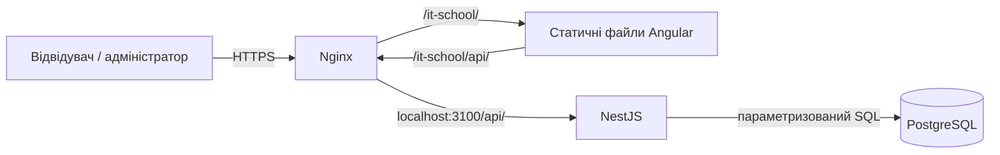

# IT.SCHOOL — документація вебзастосунку

Актуально на **19.11.2026**. Навчальний проєкт: сайт ІТ-школи, стиль **функціоналізм**, основний колір **#7A5C00**.

[Сайт](https://telegrambot.vps.webdock.cloud/it-school/) · [Репозиторій](https://github.com/andriispeed/weblab1/tree/main/Ind) · [Ролі та файли](TEAM_ROLES.md) · [Сценарій захисту](DEFENSE.md)

## 1. Призначення

Відвідувач може порівняти курси, переглянути програму та залишити заявку. Адміністратор переглядає заявки, змінює їхні статуси й оновлює інформацію про курси. Дані зберігаються на сервері, тому доступні з іншого пристрою та після перезавантаження сторінки.

Проєкт містить чотири основні типи сторінок: головну, каталог, деталі курсу й контакти. Додатково реалізовані вхід, адмінпанель, сторінка порівняння CR15 та сторінка невідомого маршруту.

Це навчальний застосунок: платежів, автоматичних листів, особистого кабінету студента та реального зарахування до школи немає. Статус «Зараховано» — запис у навчальній системі.

## 2. Команда

| Учасник | Відповідальність |
|---|---|
| **Шкіндер Андрій** | Бекенд, PostgreSQL, сервер, розгортання, адмінпанель, авторизація та взаємодія з API |
| **Карпець Олександр** | Angular-сторінки, компоненти, навігація та каталог курсів |
| **Хомяк Дар’я** | Адаптивна верстка, CSS/SCSS, стилі та градієнти |
| **Арсеній Липський** | Форма запису, клієнтська валідація, помилки та підтвердження заявки |

Цей розподіл стосується розробки вебзастосунку. Ролі з проєктування макетів у Figma сюди не входять.

## 3. Технології

| Рівень | Технології | Використання в проєкті |
|---|---|---|
| Інтерфейс | Angular 20.3, TypeScript | Standalone-компоненти, маршрути, signals, Reactive Forms |
| Оформлення | SCSS, CSS Grid, Flexbox | Сітка, компонування, адаптивність і градієнти |
| HTTP-клієнт | Angular HttpClient, RxJS | Запити до API, обробка результатів і помилок |
| API | NestJS, Node.js | Контролери, DTO, перевірка доступу та бізнес-операції |
| Дані | PostgreSQL 17, драйвер pg | Параметризовані SQL-запити, транзакції та міграції |
| Хостинг | Ubuntu, Nginx, HTTPS | Видача Angular і проксіювання API |
| Сервіси | Docker Compose | API та база в окремих контейнерах |
| Перевірки | Playwright, GitHub Actions | Браузерний сценарій, збірка й інтеграційний тест API |

Градієнт є можливістю CSS. Angular керує станом інтерфейсу та даними; спеціальної бібліотеки для градієнтного тексту немає.

## 4. Архітектура



Angular збирається до HTML/CSS/JavaScript. У production не працює `ng serve`: готові файли віддає Nginx. API слухає локальний порт 3100, а PostgreSQL не має порту, відкритого в інтернет. Основний застосунок на цьому VPS продовжує працювати за кореневою адресою.

## 5. Структура файлів

```text
Ind/
  frontend/src/
    main.ts                     # запуск Angular і реєстрація провайдерів
    styles.scss                 # спільні стилі й медіазапити
    styles/_tokens.scss         # згенеровані CSS-змінні
    app/
      app.ts, app.html          # оболонка, меню, футер із командою
      routes.ts                 # маршрути й lazy loading
      core/api.ts               # HTTP, сесія, interceptor, adminGuard
      shared/course-card.ts     # картка курсу
      pages/                    # сторінки та їхні шаблони
  backend/src/
    main.ts                     # запуск NestJS, middleware, Swagger
    controllers.ts              # публічні, auth- і admin-endpoints
    dto.ts                      # перевірка вхідних даних
    security.ts                 # сесії, scrypt, guard, rate limit
    database.ts                 # пул PostgreSQL і транзакції
    migrations/initial.ts       # таблиці та початкові курси
  backend/test/api.mjs           # ізольований інтеграційний тест
  infra/                        # Compose, Nginx, deployment, backup
  scripts/                      # токени, пакування, deploy, E2E
  docs/                         # документація та матеріали захисту
  design/tokens.json            # джерело кольорів сайту
  legacy/static/                # попередня статична версія
```

Локальні матеріали макетів залишені в `design/`, але **не входять у production-пакет**. Адреси `/it-school/design-preview` і `/it-school/design-preview/*` повертають **410 Gone**. Сторінка `/design` містить лише вебпорівняння CSS-градієнта.

## 6. Сторінки та поведінка

У таблиці наведені маршрути відносно `/it-school/`.

| Маршрут | Основні можливості |
|---|---|
| `/` | Концепція школи, переваги, курси з API, перехід до запису |
| `/courses` | Категорії «Усі», «Розробка», «Тестування»; пошук; сортування ціни; скидання фільтрів |
| `/courses/:id` | `frontend`, `python`, `qa`; опис, ціна, модулі програми, FAQ, передача курсу у форму |
| `/contact?course=qa` | Обраний напрям, форма, валідація, надсилання, номер заявки |
| `/admin/login` | Вхід команди |
| `/admin` | Заявки, пошук, статуси, пагінація, видалення з підтвердженням, редагування курсів та історія дій |
| `/design` | Три режими: початковий, градієнт основного тексту, компроміс |
| Невідомий маршрут | Повідомлення та посилання назад до каталогу |

Пошук і сортування **публічного каталогу** виконуються в Angular над отриманими курсами. Пошук, фільтр і пагінація **заявок адміністратора** виконуються через серверні запити.

## 7. Шлях заявки

1. Сторінка курсу передає `course` через query-параметр до форми.
2. `ContactPage` створює Reactive Form і перевіряє поля. Перед відправленням прибирає крайні пробіли в імені та email.
3. При помилці показується підказка й фокус переходить до першого некоректного поля. Під час надсилання повторне натискання блокується.
4. Форма викликає метод `Api.apply()`, який надсилає JSON у `POST /applications`.
5. NestJS перевіряє Origin, розмір тіла, DTO та частоту запитів. База зберігає заявку.
6. Відповідь містить номер і дату. Лише після успішної відповіді відображається підтвердження.
7. Адміністратор отримує список через захищений API та може змінити статус.

`requestId` генерується один раз для поточної заявки. Повторний запит із тим самим номером і даними повертає наявний запис. Той самий номер з іншими даними дає 409. Це доповнює блокування кнопки, яке саме по собі не захищає сервер від повторного запиту.

### Поля форми

| Поле | Правила |
|---|---|
| Ім’я | Обов’язкове, 2–80 символів; додаткова перевірка пробілів у клієнті |
| Email | Обов’язковий коректний формат, до 160 символів |
| Напрям | `consultation`, `frontend`, `python` або `qa` |
| Запитання | Необов’язкове, до 1000 символів |
| Згода | Повинна бути `true` |

Клієнтська перевірка допомагає користувачу виправити форму. Серверна перевірка залишається обов’язковою, навіть якщо запит надходить поза браузером.

## 8. База даних

| Таблиця | Основні дані |
|---|---|
| `courses` | Ідентифікатор, назва, категорія, опис, тривалість, ціна, технології, модулі JSONB, версія |
| `applications` | UUID, унікальний requestId, відбиток даних, ім’я, email, курс, повідомлення, статус, дати |
| `admin_users` | UUID, унікальний логін і хеш пароля із сіллю |
| `sessions` | Хеш токена, адміністратор, CSRF-токен, час завершення |
| `audit_log` | Адміністратор, дія, ID об’єкта, додаткові дані, дата |
| `migrations` | Застосовані версії схеми |

`applications.course_id` посилається на курс; для загальної консультації значення `NULL`. Сесії пов’язані з адміністратором. Зміна статусу або курсу та запис до журналу виконуються в одній транзакції.

Міграція виконується один раз під час запуску API. Початкові курси не перезаписуються при звичайному перезапуску. Оновлення курсу використовує поле `version`: застаріла форма отримує 409 замість перезапису новішої зміни.

## 9. API

Зовнішній префікс: **`/it-school/api`**. [Swagger](https://telegrambot.vps.webdock.cloud/it-school/api/docs/) описує маршрути й DTO; виконання запитів із Swagger UI вимкнене.

| Метод і шлях | Доступ | Призначення |
|---|---|---|
| `GET /health` | Публічний | Перевірка API та з’єднання з БД |
| `GET /courses` | Публічний | Каталог |
| `GET /courses/:id` | Публічний | Окремий курс |
| `POST /applications` | Публічний, із перевірками | Створення заявки |
| `POST /auth/login` | Публічний, із rate limit | Створення сесії |
| `GET /auth/me` | Сесія | Поточний адміністратор і CSRF |
| `POST /auth/logout` | Сесія + CSRF | Завершення сесії |
| `GET /admin/applications` | Сесія | Пошук, статус, сторінки по 20 записів, лічильники |
| `PATCH /admin/applications/:id` | Сесія + CSRF | Статус `new`, `contacted` або `enrolled` |
| `DELETE /admin/applications/:id` | Сесія + CSRF | Видалення конкретної заявки |
| `PATCH /admin/courses/:id` | Сесія + CSRF | Ціна, опис і перевірка версії |
| `GET /admin/audit` | Сесія | Останні 30 дій |

Типові відповіді: 400 — некоректні поля, 401 — потрібен вхід, 403 — Origin/CSRF, 404 — невідомий об’єкт, 409 — конфлікт версії чи requestId, 429 — перевищення частоти запитів. Публічний API не повертає список або контактні дані заявників.

## 10. Вхід і захист

Пароль перевіряється через scrypt. У cookie браузера зберігається випадковий токен; у таблиці сесій — його SHA-256-хеш. Тривалість сесії — 8 годин. Production-cookie має `HttpOnly`, `Secure`, `SameSite=Strict` та шлях `/it-school/`.

`adminGuard` в Angular керує переходом до сторінки входу. Справжню перевірку доступу виконує `AdminGuard` у NestJS на кожному захищеному запиті. Для змін потрібен `X-CSRF-Token`; його додає HTTP-interceptor клієнта.

SQL-параметри передаються окремо від тексту запиту. Rate limit обмежує заявки до 12, а спроби входу до 8 за 15 хвилин на IP. Лічильники зберігаються в пам’яті одного API-процесу й скидаються при його перезапуску.

## 11. Адаптивність і CR15

Картки курсів мають 3 колонки на широкому екрані, 2 при ширині до 1000 px, 1 — до 640 px. На телефоні навігація перетворюється на меню. Використані `minmax(0, 1fr)`, відносні розміри контейнера та видимий клавіатурний фокус.

Команда обрала часткове врахування CR15: градієнт `#7A5C00 → #4F356E → #245F57` використаний у великих заголовках. Основні абзаци, ціни й поля залишені однотонними. Для темного блоку є світла палітра; для друку та forced-colors — суцільний текст.

Причина компромісу — візуальна ієрархія функціоналістичного сайту. Градієнт сам по собі не означає порушення WCAG, погіршення Core Web Vitals чи зламану сітку. [Повне обґрунтування](CHANGE_REQUEST.md).

## 12. Запуск, розгортання та перевірки

Локальний запуск описаний у [README](../README.md#запуск-локально). Основні команди з `Ind/`:

```powershell
npm ci
npm run tokens
npm run build
npm run start:api
# В іншому терміналі:
npm start
```

Перед запуском API потрібні локальна PostgreSQL та `backend/.env`, створений з `.env.example`. Для локального HTTP використовуються `COOKIE_SECURE=false` і `PUBLIC_URL=http://localhost:4200/it-school/`. Секрети не додаються в Git.

Production: `npm run package`, потім `scripts/deploy.ps1` із шляхом до SSH-ключа. Перед оновленням створюється backup; після запуску перевіряються API та Nginx. Щоденний таймер робить копію БД, залишаючи останні 14 успішних датованих копій. Контрольне відновлення проводилося в окрему БД.

[Експлуатація сервера](OPERATIONS.md) · [Архітектура](ARCHITECTURE.md) · [Перевірки](TESTING.md)

GitHub Actions перевіряє збірку, production-залежності й API на окремій PostgreSQL. Браузерний E2E перевіряє користувацький та адміністративний сценарії. Реальні заявки користувачів не є тестовими записами та не видаляються при очищенні перевірок.
